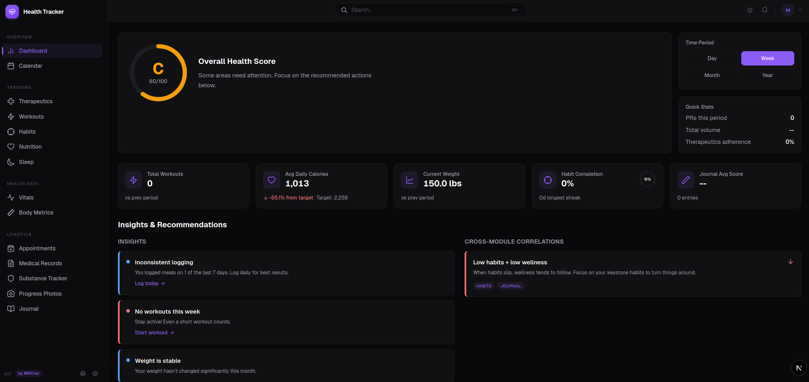
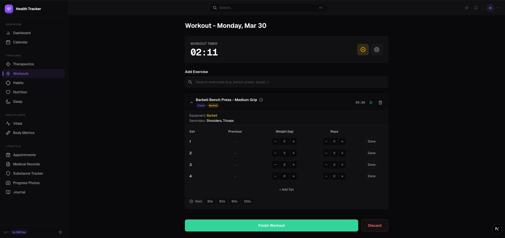
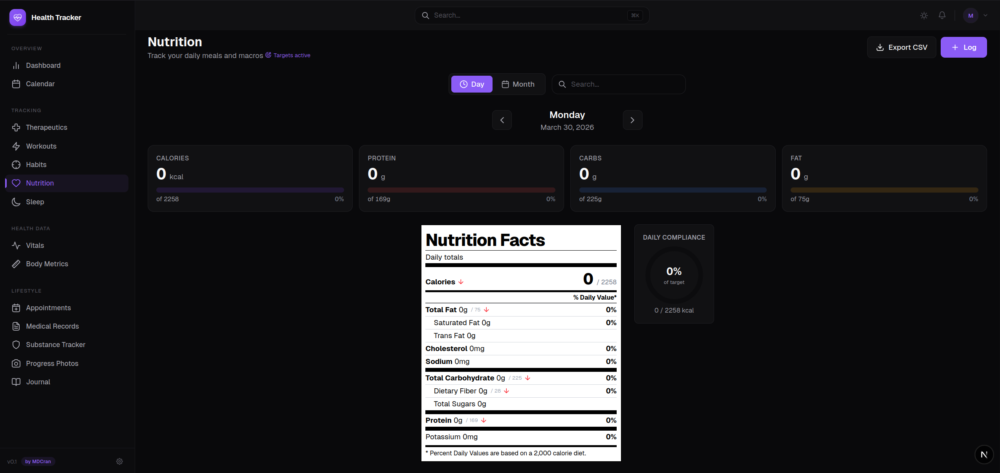

# Health Tracker

[](https://github.com/MDCran/health-tracker/actions/workflows/security-checks.yml) [](https://github.com/MDCran/health-tracker/actions/workflows/codeql.yml)

A full-stack personal health tracking application that brings workout, nutrition, and wellness logs into one interface. The repository pairs a typed Next.js client with a Java/Spring Boot API and PostgreSQL persistence.

[Project website](https://healthtracker.mdcran.com/) · [Backend source](backend/src/main/java/dev/zeroday/health) · [Frontend source](frontend/src) · [Contributing](CONTRIBUTING.md)

## Project highlights

- Workout sessions, exercise sets, templates, and personal-record tracking.
- Nutrition entries and goals, with optional OpenAI-powered food analysis.
- Body metrics, sleep, habits, journaling, vitals, and appointment views.
- A shared API client, feature-specific API modules, and client-side state stores.
- A domain-organized backend with controllers, services, repositories, and Flyway migrations.

This is a software project for personal tracking. Use synthetic data when evaluating it; these features and automated checks do not establish medical accuracy, regulatory compliance, or suitability for storing real health records.

## Stack and architecture

| Layer | Implementation |
| --- | --- |
| Web client | Next.js 16, React 19, TypeScript, Tailwind CSS 4 |
| Client data and UI | TanStack Query, Zustand, Recharts, React Aria Components |
| API | Java 21, Spring Boot 3.4, Spring Security, JWT |
| Persistence | PostgreSQL, Spring Data JPA, Flyway |
| Integrations | Optional OpenAI, exercise/nutrition providers, and Google Drive |

Dependency versions are defined in [frontend/package.json](frontend/package.json) and [backend/pom.xml](backend/pom.xml).

Start a code review with the [shared API client](frontend/src/lib/api/client.ts), [backend domains](backend/src/main/java/dev/zeroday/health), and [database migrations](backend/src/main/resources/db/migration). Runtime settings are in [application.yml](backend/src/main/resources/application.yml).

## App screenshots

Committed screenshots illustrate the application's interface.

### Dashboard



### Workout tracking



### Nutrition tracking



## Local development

Requires JDK 21, Node.js 20.9 or newer, npm, and a PostgreSQL database.

### 1. Configure a development database

The default backend configuration expects PostgreSQL at `localhost:5433`, database `personal_health`, and user `health_user`. Set `DB_PASSWORD` for that local account, or override Spring datasource settings for your own isolated development database. The initialization SQL enables [pg_trgm](docker/postgres/init.sql); Flyway applies the application's schema migrations on startup.

The repository currently does **not** include a Docker Compose file. Earlier Compose/LocalStack instructions and the referenced DigitalOcean deployment playbook do not match the tracked files. Provision PostgreSQL separately before starting the backend.

Keep credentials outside source control. Supply a local `JWT_SECRET`; review `ENCRYPTION_KEY` before using fields backed by the [encryption service](backend/src/main/java/dev/zeroday/health/common/util/EncryptionService.java). Encryption is disabled when no key is configured. Optional integrations use the environment-variable names in `application.yml`; only configure services you intend to exercise.

### 2. Start the backend

From the repository root:

```bash
cd backend
./mvnw spring-boot:run
```

Alternatively, open `backend/pom.xml` in IntelliJ and run `HealthApplication`. The default API port is **9147**. Upload storage is configured through `UPLOAD_DIR`.

### 3. Start the frontend

In a separate terminal, from the repository root:

```bash
cd frontend
npm ci
npm run dev
```

Open [localhost:3000](http://localhost:3000). The API client defaults to `http://localhost:9147`; set `NEXT_PUBLIC_API_URL` in `frontend/.env.local` when using another backend.

Stop each development server with Ctrl+C. Stop your PostgreSQL instance using the tool that created it; retain its data unless you intend to reset the development database.

## Validation and security checks

Available local commands:

```bash
# From frontend/
npm run lint
npm run build

# From backend/
./mvnw verify
```

There is no committed application test suite or frontend test script at present; a successful build or Maven verification is not evidence of end-to-end coverage.

- [CodeQL workflow](.github/workflows/codeql.yml): analyzes JavaScript/TypeScript and Java on pushes, pull requests, and a weekly schedule.
- [Security checks workflow](.github/workflows/security-checks.yml): installs frontend dependencies, runs `npm audit --audit-level=high`, and checks whitespace with `git diff --check`.
- The npm audit step is **non-blocking** (`continue-on-error: true`). A green workflow badge can coexist with reported vulnerabilities; inspect the [run logs](https://github.com/MDCran/health-tracker/actions/workflows/security-checks.yml).
- The dependency audit covers the frontend npm dependency tree, not Maven dependencies. These workflows do not run the application build or an end-to-end test suite.

Badges link to current workflow results, not a guarantee that the application is vulnerability-free.

## Deployment notes

The repository includes a [backend Dockerfile](backend/Dockerfile) and [production Spring configuration](backend/src/main/resources/application-prod.yml). Production requires separate database, secret, upload-storage, CORS, and integration configuration. The Dockerfile skips tests during packaging; do not treat an image build as a test pass.

See [CONTRIBUTING.md](CONTRIBUTING.md) for contribution and attribution guidance.
